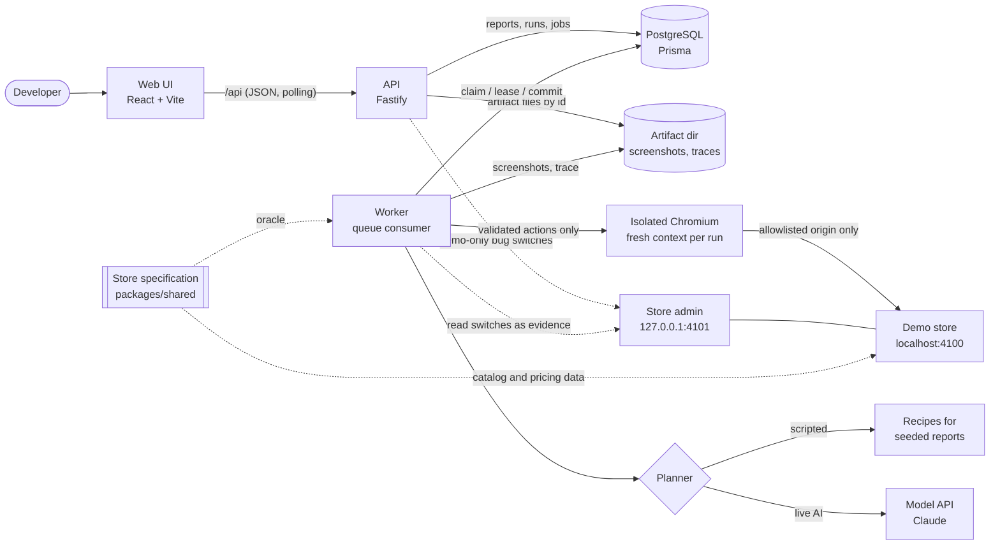
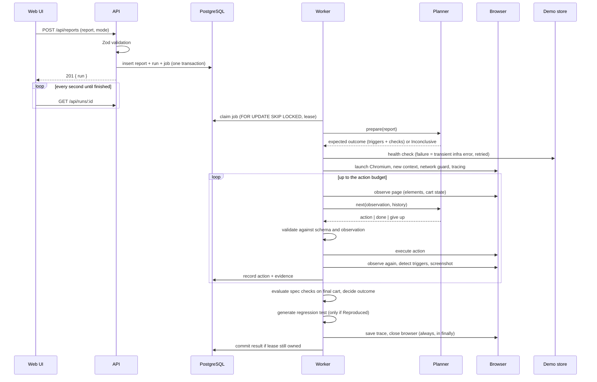
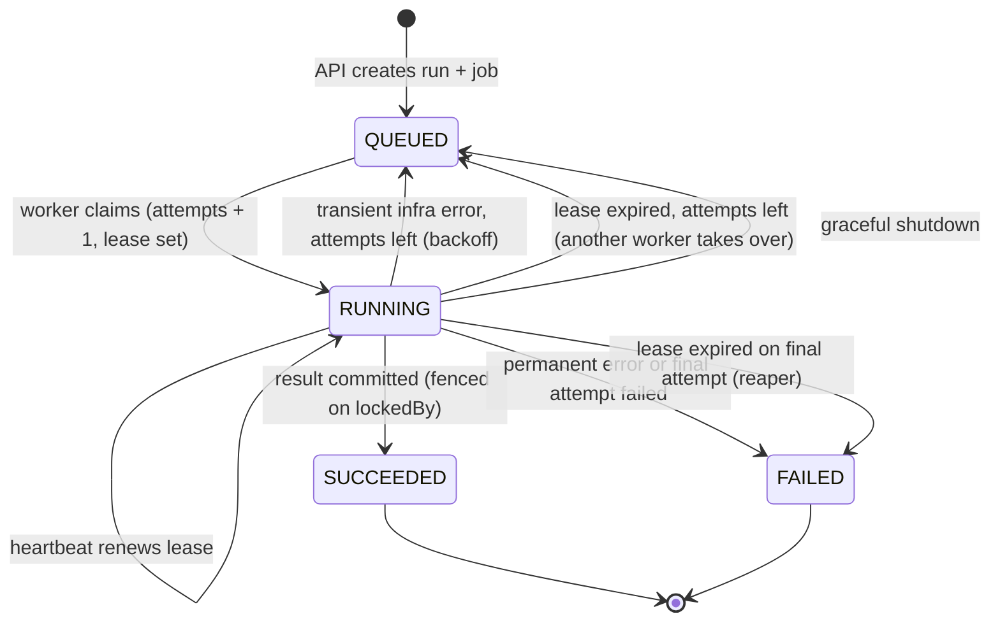

# Architecture

ReproLab is a small monorepo with four processes and one database.

- The **web UI** (React) talks only to the **API**.
- The **API** (Fastify) validates input, writes reports, runs and jobs to **PostgreSQL**, and serves results.
- The **worker** claims jobs from PostgreSQL, drives an isolated **Chromium** against the **demo store**, and
  writes the timeline, evidence and outcome back to the database and artifact folder.
- The **demo store** is the system under test. Its bug switches sit on a separate, localhost-only admin port.

## One run, step by step

## Job lifecycle

A run's **outcome** (Reproduced, Not reproduced, Inconclusive, Execution failed) is separate from its **job
status**. A job that `SUCCEEDED` may well have produced *Not reproduced*; a job that `FAILED` always yields
*Execution failed*.

## Data model

| Table | Purpose |
| --- | --- |
| `Report` | The submitted text. `seedKey` links seeded reports to scripted recipes. |
| `Run` | One reproduction request: mode, status, phase, outcome, expected outcome, check results, triggers, store switches at start, model usage, generated test. |
| `Job` | Queue entry for a run: status, attempts, `runAfter` (backoff), `lockedBy` / `lockedUntil` (lease). |
| `RunAction` | Timeline entries per attempt: validated action, description, locator, status, triggers, screenshot. |
| `RunEvidence` | Console errors, page errors, failed or error responses, blocked requests. |
| `Artifact` | Screenshots and traces: kind, content type, path relative to `ARTIFACT_DIR`. |
| `RunEvent` | Human-readable log: queued, claimed, retries, recovery, finished. |

All timestamps are `timestamptz` and every database session runs in UTC (see the evaluation report for the bug
that made this necessary).

## Trust boundaries

| Boundary | Enforcement |
| --- | --- |
| User → API | Zod schemas, strict objects (unknown keys rejected), length limits, 64 KB body limit, UUID ids |
| Model → worker | JSON schema at the API, Zod re-validation, then a check against the current observation |
| Worker → browser | Five action types; navigation only to three store routes; no `evaluate` of planner output |
| Browser → network | Origin allowlist on every request and redirect hop; WebSockets, popups, downloads, service workers blocked |
| Planner → verdict | None: outcomes come from `decideOutcome()` over observed state and the store specification |
| Generated test → disk | Fixed templates; dynamic values only as `JSON.stringify` string literals |
| API → files | Artifact lookup by id; resolved path must stay inside `ARTIFACT_DIR` |
